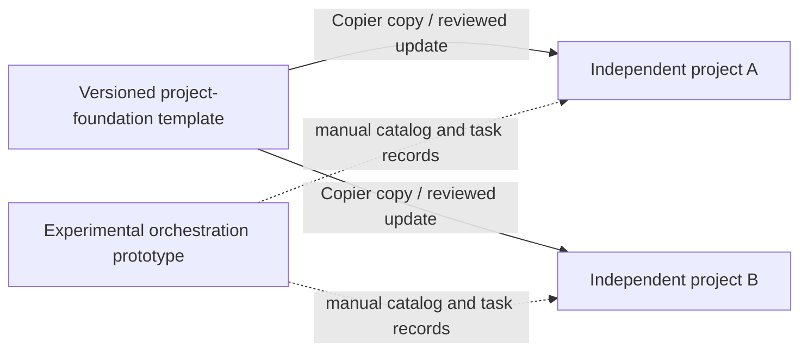

# Project foundation v0.1.2

A Copier template for independent repositories with a predictable workflow for people and coding agents. Choose one profile: `typescript-web` (Vite, React, TypeScript) or `python-service` (FastAPI, uv, a `src` package). This is a locally tested starting point, not a claim of optimal agent performance.

The template and preserved orchestration prototype share this repository. Generated projects stay independent:



Each project owns its source, task records and decisions. Copier generates only `template/`; `orchestration/` is never copied into applications. No model API, connected MCP service, production deployment or dashboard is installed by this template.

The [orchestration prototype](orchestration/README.md) preserves a tested local task/review ledger and a bounded Codex fixture trial. Custom runtime development is now closed; future coordination is intended to use [Orca](https://github.com/stablyai/orca). This source repository supports a [bounded Codex builder and independent reviewer workflow in Orca](docs/orca-workflow.md). That procedure does not establish general machine adoption or production worker containment. Automatic foundation generation/registration remains unfinished; see the [handoff](orchestration/docs/integration-plan.md).

## First project

Prerequisites: Git, Python 3.13.5 and uv 0.11.8. The web profile also requires Node 24.11.1 and its bundled npm 11.6.2. Runtime installation is an explicit machine setup step, outside the template. The local Python environment below contains Copier 9.19.1 and the foundation test tools.

Clone the public template, then generate from the local checkout:

```sh
git clone https://github.com/zouvier/project-foundation.git
cd project-foundation
UV_CACHE_DIR="$PWD/.cache/uv" uv sync --locked --python 3.13.5
.venv/bin/copier copy --defaults --vcs-ref=v0.1.2 \
  --data project_name=my-web --data profile=typescript-web "$PWD" ../my-web
cd ../my-web
git init
git add .
git commit -m "Start from project-foundation v0.1.2"
./project doctor
./project bootstrap
./project check
./project build
./project dev
```

The first `doctor` returns nonzero because dependencies have not been installed. `bootstrap` is the explicit network/install operation. After it completes, `doctor` should pass. For a Python service, generate with a distinct name and `--data profile=python-service`. The destination must be new: inspect it before running Copier, and do not generate over an existing project. Keep the quoted absolute template source `"$PWD"`: Copier records that source for updates from the generated repository. A relative `.` source does not provide stable lineage across working directories.

To record the public GitHub URL directly as the project's future update source, use this alternative after installing Copier in the foundation environment:

```sh
.venv/bin/copier copy --defaults --vcs-ref=v0.1.2 \
  --data project_name=my-service --data profile=python-service \
  https://github.com/zouvier/project-foundation.git ../my-service
```

Both recipes use an immutable release. The local-source recipe requires keeping the clone at a stable absolute path; the URL recipe retains the GitHub URL in Copier lineage.

Open the generated folder with `code .`. VS Code's **Run Task** lists the same six project commands; no extension is required and no tasks run automatically. Any editor or terminal can use the same commands.

| Command | Contract |
| --- | --- |
| `./project doctor` | Read-only readiness report; returns nonzero for missing prerequisites/dependencies or basic contract problems |
| `./project bootstrap` | Explicit network installation from committed locks into local dependency directories |
| `./project dev` | Foreground server on 127.0.0.1; Ctrl-C stops it; `PORT=...` selects 1024–65535 |
| `./project check` | Contract, schema, static dependency boundaries, type/lint checks and non-watch tests; no installation; detects changes made during checking to tracked and untracked project inputs |
| `./project test` | Native non-watch test discovery; a fresh machine-readable report must show at least one actual pass; missing/all-skipped tests fail |
| `./project build` | Local build artifacts only; no publish/deploy |

Commands run relative to their own project root, including when called from another directory. The supported target is macOS/Linux; local verification is on macOS arm64. Linux CI is provided but is not claimed to have run. Native Windows is not verified.

The Python profile verifies that its editable installation and imported application code belong to the current repository. Canonical commands normalize conflicting Python/uv environment overrides, and pytest checks actual module and test-source origins. A stale wheel or another project's prepared environment requires explicit bootstrap; acceptance never installs implicitly. The runner requires `/usr/bin/env -S` and starts Python in isolated mode. See the generated [environment contract](template/docs/upgrading.md#python-environment-contract) for supported customization and limits.

## Ownership and upgrades

Copier owns the project command, `.project` schemas/checks/roles/metadata/provenance receipt, `AGENTS.md`, tool configurations, lockfiles, CI and VS Code tasks. Source, tests, project README, architecture, decisions and task records are seeded once and excluded on updates. See the generated [upgrade guide](template/docs/upgrading.md) for the exact ownership table and procedure.

Always update on a clean branch using a pinned release. Review the diff, resolve conflicts and run acceptance checks. Never edit the Copier lineage answers manually or use `recopy` as an upgrade shortcut. Profiles and project identity are fixed for a project in v0.1; changing them requires an explicit migration. Keep the local template at a stable location: Copier records its source path. The public template URL is `https://github.com/zouvier/project-foundation.git`. Choose the intended source when generating; moving existing lineage requires a separate reviewed migration.

## Working with agents

`AGENTS.md` is a short map to the project command, architecture and a single task/handoff record. Role prompts are optional, plain Markdown in `.project/roles/`. There is no provider-specific adapter or personal authentication copied into projects. Start with a concrete task and observable acceptance checks, then record actual results and unrun checks in the same JSON task record.

These records organize work, not permissions. Static import rules enforce the documented ordinary module boundaries; they are not a security sandbox. Git worktrees separate working files, not credentials or network access. The preserved orchestration prototype does not establish production worker containment.

## Maintaining the foundation

Run the deterministic integration suite explicitly (it installs packages in disposable fixtures and briefly starts localhost servers):

```sh
mkdir -p .artifacts
FOUNDATION_INTEGRATION=1 .venv/bin/python -m pytest tests -q \
  --basetemp=.artifacts/pytest
```

Without `FOUNDATION_INTEGRATION=1`, network/runtime integration tests skip; do not report that as full acceptance. The suite generates two unique repositories per profile, exercises success and failure behavior, and tests Copier updates against user edits, deletions and managed-file conflicts. [Verification evidence](docs/verification.md) records the exact run, failures fixed and limits. [Fresh-agent pilot](docs/pilot.md) describes a separate later acceptance exercise.

To maintain dependency locks, use Copier with an absolute template source to render a disposable project named `foundation-lock-seed`, update the exact manifest pins, and run the ecosystem lock tool there (`npm install --package-lock-only --ignore-scripts` or `uv lock`). Copy the resulting lock back to its conditional template path, replacing only the exact project-name string `foundation-lock-seed` with the Jinja variable `{{ project_name }}`. Update the normalized reserved dependency-name list in `copier.yml` from both lock graphs; collision tests exercise every valid locked name. Re-run the entire fixture matrix with at least two names per profile. Do not hand-edit resolved dependency versions or integrity hashes in lockfiles.

The template has no Copier tasks, migrations, Jinja extensions or `--trust` requirement. Review and release a new immutable tag after changes pass. Do not move existing release tags.

The preserved prototype has a separate offline suite:

```sh
cd orchestration
python3 -B -m unittest discover -s tests -v
```

No model requests are made by either suite. Further design context: [research memo](docs/research.md), [foundation decision](docs/decisions/0001-foundation.md), and [coordination handoff](docs/company-workspace.md).

## Public release lineage and license

This repository begins with a privacy-sanitized public history based on the audited v0.1.2 template. Original private implementation commits and machine-specific evidence are not included. See [public release lineage](docs/public-release.md) and [verification scope](docs/verification.md).

No project license has been selected or declared. Dependency license metadata remains intact.
